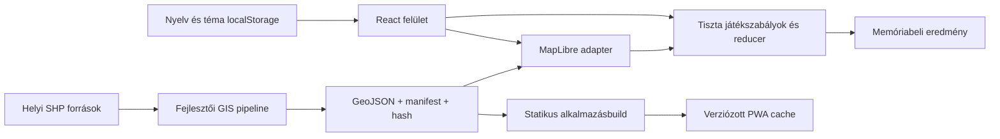

# TopoGok – műszaki design

Állapot: megvalósítás előtti terv a tulajdonos által elfogadott termékdöntésekhez. Nincs alkalmazáskód. Az itt választott modulhatárok és interfészek a követelmények végrehajtható kibontásai.

## Architektúra

Statikus React SPA, TypeScript strict, Vite build, CSS Modules, MapLibre GL JS megjelenítés. PWA integráció: vite-plugin-pwa, felhasználói frissítési jóváhagyással. Kliensoldali állapot reducerben, nincs Redux, backend, adatbázis, SSR vagy fiókszolgáltatás. Node/npm és függőségverziók implementációkor együtt ellenőrzendők és lockfile-ban rögzítendők; nem kell előre kitalált verziót követni.



## Javasolt fájlszerkezet

```text
src/
  app/                 App, AppState, providers, ErrorBoundary
  components/          Button, Dialog, SelectGroup, StatusMessage
  features/home/       HomeScreen
  features/setup/      SetupScreen
  features/game/       GameScreen, QuestionPanel, Feedback, Timer
  features/results/    ResultScreen
  features/explore/    ExploreScreen
  features/help/       HelpScreen, AboutScreen, InstallHelp
  domain/              types, config, shuffle, scoring, reducer, clock
  map/                 MapView, InsetMap, mapAdapter, mapStyle, hitTest
  data/                topicRegistry, loadTopic, validation
  i18n/                hu.json, uk.json, translator
  preferences/         preferencesStore
  pwa/                 registration, updateCoordinator
  styles/              tokens.css, global.css
scripts/data/          export, normalize, validate, report
public/data/           verziózott generált csomag
tests/unit/            domain, locale, preferences
tests/integration/     UI-state együttműködés
tests/e2e/             valós böngésző és produkciós PWA build
```

A szerkezet irányadó: összevonható kisméretű modul, de domain logika ne kerüljön map click callbackbe vagy JSX-be. A README gyökérben marad, az SHP input nincs a public alatt. A backups sem kerül buildbe.

## Felelősségek és interfészek

| Modul | Felelősség | Nem feladata |
|---|---|---|
| domain | konfiguráció, sorsolás, válasz, pont, jegy, állapotátmenet | DOM, fetch, localStorage, MapLibre |
| Clock | injektálható elapsed és lejáratvizsgálat | pontozás, szerveres időhitelesítés |
| data | manifest/GeoJSON validáció, verzióegyezés, egyszeri betöltés | adminfelület, fájlfeltöltés |
| map | renderelés, geometriai találat → feature ID | megoldás helyességének eldöntése |
| UI | input, megjelenítés, navigáció, lokalizált visszajelzés | saját alternatív pontozás |
| preferences | két egyszerű beállítás olvasása/mentése | eredmény vagy kör tárolása |
| PWA | teljes csomag cache, telepítésjelzés, késleltetett frissítés | aktív kör erőszakos újratöltése |

Map adapter felület: `setSelection(id|null)`, `setFeedback({wrongIds,correctId})`, `resetView()`, `setTheme(theme)`, `setLocale(locale)`, `destroy()`, `onSelect(id)` és `onReady()`. Számonkérésben `setFeedback` mindig üres állapotot kap. A map adapternek a kérdés helyes ID-ját nem szükséges megkapnia, kivéve már engedélyezett gyakorló megoldásrajzoláskor. Így a találati prioritás nem függhet a helyes választól.

## Állapot és adattípusok

```ts
type Mode = 'practice' | 'assessment';
type QuestionCount = 5 | 12 | 'all';
type GameConfiguration =
  | { mode:'practice'; topicId:string; count:QuestionCount; showElapsed:boolean }
  | { mode:'assessment'; topicId:string; count:QuestionCount;
      timeLimitMinutes:null | 5 | 10 | 15 | 20 };
type Question = { featureId:string };
type Answer = { selectedId:string; elapsedMs:number };
type PracticeItem = { featureId:string; answers:Answer[];
  revealed:boolean; closed:boolean; points:0|30|60|100 };
type AssessmentResult = { mode:'assessment'; total:number; correct:number;
  durationMs:number; percent:number; grade:number;
  finishReason:'completed'|'timeout'; appVersion:string; dataVersion:string };
type PracticeResult = { mode:'practice'; total:number; firstTryCorrect:number;
  points:number; maxPoints:number; percent:number; durationMs:number;
  appVersion:string; dataVersion:string };
```

A diszkriminált konfiguráció kizárja a gyakorlás időkorlátját és vizsga showElapsed kapcsolóját. A result típust runtime nem tároljuk; app/data verzió technikai mező, a fő eredménykártyán nem kötelező mutatni. Ne vezessünk be ResultRepository/AuthService/LeaderboardService üres osztályokat. Későbbi mentés a lezárási határra köthető majd.

App szintű nézetek: home, setup, loading, playing, results, explore, help, error. A playing reducer fázisai: answering, feedback, transitioning; a gyakorlásban base/review szakasz. A megszakított kör törlődik, nem jelenik meg eredményként. Loading alatt nem él a timer. A view nem URL-ben hordozott teljes állapot; nincs megosztható feladatsor.

### Eseménytábla

| Esemény | Előfeltétel | Hatás |
|---|---|---|
| START | valid config + valid data + map ready | új sorsolás, kezdő idő, answering |
| SELECT | answering, ismert ID, nem lejárt | kijelölés; nem pontoz |
| CONFIRM | answering + kijelölés | előbb deadline ellenőrzés, majd mód szerinti válaszfeldolgozás |
| REVEAL | practice answering | 0 pont, megoldás, feedback |
| NEXT | practice feedback | következő alap/ismétlő feladat vagy eredmény |
| TIME_CHECK | aktív assessment | lejárt esetben egyszeri lezárás |
| CHANGE_LOCALE/THEME | bármely nézet | csak megjelenés/pref, nem domain reset |
| RESTART_CONFIRMED | aktív vagy eredmény | régi állapot eldobása, azonos config, új kör |
| EXIT_CONFIRMED | aktív | időzítők és kör törlése, főoldal |

Dupla események ellen a reducer állapota a védelem; a disabled gomb önmagában kevés. A véglegesítés és timeout ugyanazon soros átmeneten jut át. Aktív időzítők és MapLibre listenerek unmountnál felszabadítandók; fejlesztői React Strict Mode újrainicializálás nem duplázhatja őket.

## Térképi renderelés és találat

Saját üres MapLibre style: háttér, country fill/outline, question fill/outline, kijelölési és gyakorló feedback rétegek. Nincs külső tile/style/glyph URL. A feature ID a GeoJSON `id`; a kiválasztás és feedback feature-state vagy szűrt réteg alapján készül. Témaváltásnál a kiválasztás nem veszhet el.

A kitöltött kérdésrétegen fut a hit-test, nem az ország háttérrétegén. Csak a 27 ID engedett. Drag/pinch utáni esemény ne váljon válasszá. Nem növelünk láthatatlan találati területet: a két kis egységre betét és normál zoom szolgál. Több renderelt találat esetén deduplikált ID-lista, majd stabil geometriai/rajzolási sorrend dönt (városi poligon a környező fölött; egyéb egyezésnél stabil ID). A keresett válasz soha nem prioritási szempont. Üres találat nem törli és nem adja be a kijelölést.

Nincs körbeforgó világismétlés, 3D pitch vagy rotáció. A maximális térképhatár az ország bboxa dokumentált paddinggel; reset teljes országot mutat, a vezérlők és mobil panel figyelembevételével. ResizeObserver és map.resize kezeli az elrendezés/orientáció változását. Betétek ugyanazt a GeoJSON-t használják és ugyanarra a kijelölésre reagálnak, egyszerre legfeljebb egy extra MapLibre példánnyal.

A felfedező nézet címkéihez helyi HTML/SVG overlay vagy a csomaggal szállított helyi glyph-megoldás használható. V1 javaslat: térképpozícióhoz kötött DOM feliratok, mert 27 névhez nincs szükség külső fontszolgáltatásra. A poligon belső pontját kell használni, nem a bbox közepét, ha az kívül eshet. Az ütköző címkéket zoomfüggően kezeljük, kattintásra a teljes név mindig olvasható.

WebGL hiba esetén lokalizált hiba és újrapróbálás, nem üres oldal. Renderer nélküli névlista nem helyettesíti a vizsgát és nem ad jegyet. A csomag és worker lokálisan kerül a buildbe. A pontos worker-import az implementációkor kiválasztott MapLibre-verzió hivatalos dokumentációjához igazodjon, és produkciós CSP mellett legyen tesztelve.

## Tárolás és navigáció

`localStorage['topogok.preferences.v1'] = {locale?:'hu'|'uk',theme:'system'|'light'|'dark'}`. A tároló parse/írás hibáját elkapjuk, memória fallback. Nincs IndexedDB játékeredménynek, sessionStorage körnek, cookie azonosítónak vagy URL query tanulói adatnak. A service worker cache kizárólag statikus erőforrásokat tárol, ami nem eredménymentés.

Aktív körben belső navigáció megerősítéssel történik. A böngésző Back nem navigálhat korábbi kérdésállapotra: kérdésenként nincs history entry. A SPA gyökérútvonal használata elég; a súgó és főoldal lehet belső nézet. Oldalfrissítés főoldalra tér vissza. Mobil bfcache visszatérésnél a még létező memóriabeli kör határidejét újra ellenőrizzük.

## Offline és kiadás

Precache: HTML, JS/CSS chunkok, helyi worker, ikonok, manifest, hu/uk szótárak, country/regions/manifest fájlok, minden szükséges egyéb helyi erőforrás. A plugin fájlméret-korlátja nem hagyhat ki nagy JS/GeoJSON fájlt észrevétlenül: build során a lista teljesülését ellenőrizzük. A cache-től független online-first data fetch nem megengedett.

`registerType:'prompt'` szemlélet, aktív körben nincs skipWaiting/updateServiceWorker hívás. Több nyitott tab esetén BroadcastChannel vagy ekvivalens koordináció jelzi az aktív játékokat; egy másik tab frissítése sem töltheti újra a játszó tabot. Ismeretlen peer-állapotnál halasszuk a frissítést. A legegyszerűbb fallback a frissítés aktiválása az összes régi tab bezárása utáni induláskor. Régi aktív kliens által használt cache nem törölhető alóla. Ezekhez külön A→B frissítési E2E kell.

Teljes új csomag installjának hibája esetén a korábbi működő csomag maradjon használható. App/data hash párosítás validációja kizárja az új manifest + régi geometriák keveredését. A rollback CDN-művelet önmagában nem cseréli le a kliens SW-jét; részletek az üzemeltetési tervben.

## Biztonság és hibaágak

Nincs titok a frontendben. A konfiguráció futáskor validált; hibás érték nem jut pontozásba. Adatbetöltési hiba, sérült manifest, hiányzó nyelv/ID, hash-eltérés esetén kezdés tiltva és újrapróbálás. HTML-ként nem renderelünk fordítást vagy adatnevet. Fejléc: CSP, nosniff, no-referrer, frame-ancestors tiltás; MapLibre worker/style szükségletekkel együtt ellenőrizve, nem teszteletlenül bemásolt maximális tiltás.

A jegyek kliensoldaliak és nem hitelesek távoli ellenőrzéshez. Nincs „biztonságos teszt” vagy „ellenőrzőkód” marketing. A tanári felügyelet termékfeltétel; nem készítünk látszat csalásvédelmet.

## Követelmény–design megfeleltetés

| AC | Megvalósítási felelősség |
|---|---|
| 01, 03 | Home/Setup, config validator, shuffle |
| 02, 22 | adatpipeline, manifest, runtime loader |
| 04, 13, 14 | MapView, InsetMap, hitTest, saját style |
| 05–07 | practice reducer, pontozás, Explore elkülönítés |
| 08–11 | assessment reducer, Clock, ResultScreen |
| 12 | navigáció, reset, memóriabeli session |
| 15 | i18n + adatnevek, locale provider |
| 16–18 | preferences, CSS tokenek, komponensek, reszponzív elrendezés |
| 19–20 | PWA cache és update coordinator |
| 21 | nincs szolgáltatási backend/mentés, scope ellenőrzés |
| 23–25 | CI, tesztterv, kiadási és bizonyítéknapló |

## Kockázatok és alternatívák

MapLibre előnye a zoom/pan és későbbi geometriák kezelése; hátránya a WebGL/worker/CSP és csomagméret. SVG renderer kisebb lehetne, de új választás lenne a jóváhagyott stackhez képest: mérési hiba esetén dokumentált módosítási javaslatként kezeljük. Backend most aránytalan, hiteles távoli vizsgához később kell. Nyers SHP böngészős import fölösleges, mert a fejlesztő készíti a tartalmat. Túlzott egyszerűsítés veszélye a kis városok elvesztése; v1-ben alapból ne egyszerűsítsünk.
